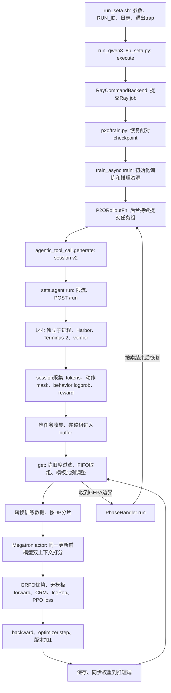
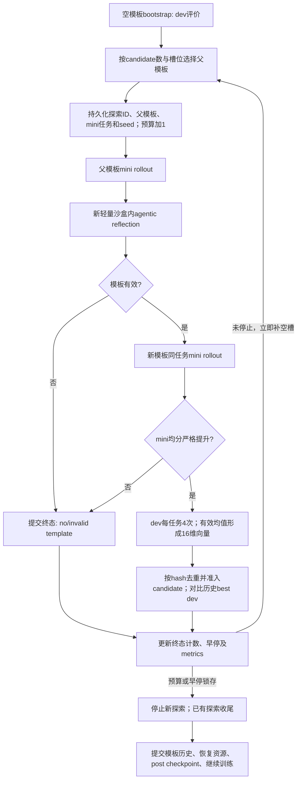

# P2O + SETA：调用链、异步取样与沙盒隔离

核对日期：2026-11-05。本文描述当前工作区的实际实现，代码链接定位到本次核对的行号；函数名可用于代码变动后的检索。算法约定见 [主计划](../P2O_SETA_PLAN.md)，启动与恢复操作见 [使用说明](p2o_seta_usage.md)，此前GPU验收见 [实现记录](p2o_implementation_progress.md)。初次核对读取代码、已有日志和144服务配置；随后按用户要求修改共享默认值、GEPA引擎继承与耗时记录，并运行CPU测试；未申请GPU、启动模型、重启服务或取消在线任务。

## 1. 从启动脚本到一次参数更新

### 1.1 主调用图



图中的“后台持续提交”与训练并行；`get` 只是消费已完成任务组，不负责等一个同步rollout批次全部结束。GEPA阶段则暂停训练，详见第3节。

### 1.2 启动与配置进入消费者

| 顺序 | 代码位置 | 作用 |
| --- | --- | --- |
| 1 | [my_scripts/run_seta.sh:109](/ceph_home/zhangkaiqi2024/miles/my_scripts/run_seta.sh:109)；[my_scripts/run_seta.sh:277](/ceph_home/zhangkaiqi2024/miles/my_scripts/run_seta.sh:277) | `SETA_ALGORITHM=p2o` 选择实验；生成实验名、保存路径、独立RUN_ID，写本次run记录，调用Python启动器。共享shell仍默认DAPO；GRPO/DAPO后缀脚本复用它。 |
| 2 | [scripts/run_qwen3_8b_seta.py:198](/ceph_home/zhangkaiqi2024/miles/scripts/run_qwen3_8b_seta.py:198) | 组装数据、session v2、GRPO优势、PPO clip、IcePop、优化器、原生训推拓扑参数；DAPO额外启用同分过滤，GRPO/P2O不启用。 |
| 3 | [scripts/run_qwen3_8b_seta.py:263](/ceph_home/zhangkaiqi2024/miles/scripts/run_qwen3_8b_seta.py:263)；[scripts/run_qwen3_8b_seta.py:131](/ceph_home/zhangkaiqi2024/miles/scripts/run_qwen3_8b_seta.py:131) | P2O选择专用薄入口，注册`P2ORolloutFn`、`P2ODataBuffer`、`score_contexts`三个扩展；GEPA参数实际传给相应消费者。 |
| 4 | [scripts/run_qwen3_8b_seta.py:314](/ceph_home/zhangkaiqi2024/miles/scripts/run_qwen3_8b_seta.py:314)；[miles/utils/external_utils/command_utils/ray_backend/backend.py:29](/ceph_home/zhangkaiqi2024/miles/miles/utils/external_utils/command_utils/ray_backend/backend.py:29) | 使用原生command backend提交Ray job；`job_lifetime="launcher"`使启动器退出时停止对应job。正常卡数由既有布局配置决定。 |
| 5 | [examples/seta/p2o/train.py:12](/ceph_home/zhangkaiqi2024/miles/examples/seta/p2o/train.py:12)；[examples/seta/p2o/driver.py:81](/ceph_home/zhangkaiqi2024/miles/examples/seta/p2o/driver.py:81) | 先选模型/P2O配对checkpoint，再执行参数校验，调用原生`train_async.train(..., phase_factory=PhaseHandler)`，不是另写一个PPO训练器。 |
| 6 | [train_async.py:23](/ceph_home/zhangkaiqi2024/miles/train_async.py:23) | 创建worker manager、inference controller、rollout executor和actor，初始化并同步模型；P2O注入phase handler，训练更新仍走原生actor。 |

共享脚本和Python字段均允许显式覆盖。不要只看Python的字段默认值推断实际run配置：shell会覆盖部分字段（例如保存频率），最终以日志中的生效参数为准。

### 1.3 自然采样、模板选择与真实轨迹生成

1. [miles/rollout/data_source.py:83](/ceph_home/zhangkaiqi2024/miles/miles/rollout/data_source.py:83) 从当前epoch的shuffle排列按游标取任务；用 `materialize_samples` 为每个任务复制K个独立episode并分配 `group_index/index`。自然数据流在epoch内无放回；P2O主动混入的历史难任务可能重复，不推进自然游标。
2. [examples/seta/p2o/sampling.py:15](/ceph_home/zhangkaiqi2024/miles/examples/seta/p2o/sampling.py:15) 按8个任务构成提交窗口。先取重试/之前被替换而延后的任务，再从自然数据补齐；按25%–50%调整本窗口的模板任务数，具体见第2节。窗口是采样配额单位，不是8组必须同步启动或同步完成。
3. [examples/seta/p2o/coordinator.py:55](/ceph_home/zhangkaiqi2024/miles/examples/seta/p2o/coordinator.py:55) 为每条episode保存来源、cycle、模板hash与注入标记。历史模板选择由 [examples/seta/p2o/history.py:109](/ceph_home/zhangkaiqi2024/miles/examples/seta/p2o/history.py:109) 管理：已知能解决该任务的模板优先，其次旧分配，否则全历史池；各GEPA轮的非空有效模板dev均分先轮内z-score，再softmax。零方差时z-score为0。K条episode可以抽到不同模板。
4. [miles/rollout/fully_async_rollout.py:155](/ceph_home/zhangkaiqi2024/miles/miles/rollout/fully_async_rollout.py:155) → `_generate_group` → 原生 `generate_and_rm_group`。P2O覆写任务来源和收尾，复用组生成器与scheduler。
5. [miles/rollout/generate_hub/agentic_tool_call.py:52](/ceph_home/zhangkaiqi2024/miles/miles/rollout/generate_hub/agentic_tool_call.py:52) 创建session v2 tracer，调用 `examples.seta.agent.run`。它提供回连模型地址和session身份；Harbor中的每轮模型请求回到Miles session服务，再发到SGLang。
6. [examples/seta/agent.py:21](/ceph_home/zhangkaiqi2024/miles/examples/seta/agent.py:21) 先获取run内沙盒额度和endpoint额度，生成独立request UUID，传 `SETA_RUN_ID`；通过 [examples/swe-agent-harbor-docker/swe_agent_function.py:82](/ceph_home/zhangkaiqi2024/miles/examples/swe-agent-harbor-docker/swe_agent_function.py:82) 的HTTP客户端调用144的 `/run`。
7. [seta_miles_runtime/harbor/miles_agent_server.py:138](/ceph_home/zhangkaiqi2024/miles/seta_miles_runtime/harbor/miles_agent_server.py:138) 登记run/session身份，等待服务全局semaphore；[seta_miles_runtime/harbor/agent_server/trial_runner.py:443](/ceph_home/zhangkaiqi2024/miles/seta_miles_runtime/harbor/agent_server/trial_runner.py:443) 为每条episode启动独立进程，加载SETA runner。
8. [examples/seta/harbor_trial.py:68](/ceph_home/zhangkaiqi2024/miles/examples/seta/harbor_trial.py:68) 构建任务环境、设置独立trial名称并运行Harbor；[examples/seta/terminus.py:22](/ceph_home/zhangkaiqi2024/miles/examples/seta/terminus.py:22) 将模板注入实际instruction，Terminus-2多轮读模型输出并执行工具，最后运行verifier。奖励保留 `passed/total + 0.2 × 全通过标志`。
9. 模型请求、输出和实际behavior logprob记录在session内。agent结束或失败后，`agentic_tool_call.generate`仍尝试收集；[examples/seta/agent.py:76](/ceph_home/zhangkaiqi2024/miles/examples/seta/agent.py:76) 保留原生动作token归属，检查奖励有效性并验证双上下文。无效episode标为ABORTED，不能冒充训练零奖励。
10. [examples/seta/p2o/rollout.py:153](/ceph_home/zhangkaiqi2024/miles/examples/seta/p2o/rollout.py:153) 先观察完整组，按无bonus的progress收集难任务，再 `attach_training_context` 附加去模板所需的token前缀；结果交给buffer。Miles以完整episode/分支归属处理多轮数据，不把每个terminal turn当一个独立GRPO任务。

### 1.4 从buffer到optimizer.step

| 环节 | 代码位置 | 数据/行为 |
| --- | --- | --- |
| 取batch | [miles/rollout/fully_async_rollout.py:211](/ceph_home/zhangkaiqi2024/miles/miles/rollout/fully_async_rollout.py:211) → [miles/rollout/fully_async_data_buffer.py:215](/ceph_home/zhangkaiqi2024/miles/miles/rollout/fully_async_data_buffer.py:215) | 获取当前已发布模型版本；先过滤过期组，再取8个完整任务组，每组K=16。P2O选择函数见下一节。 |
| 包装 | [miles/ray/rollout/rollout_executor.py:171](/ceph_home/zhangkaiqi2024/miles/miles/ray/rollout/rollout_executor.py:171) → [miles/ray/rollout/train_data_conversion.py:60](/ceph_home/zhangkaiqi2024/miles/miles/ray/rollout/train_data_conversion.py:60) | 带上tokens、response lengths、原动作mask、rollout logprob和P2O train_metadata，并按DP分片。 |
| 奖励归一化 | [miles/ray/rollout/train_data_conversion.py:293](/ceph_home/zhangkaiqi2024/miles/miles/ray/rollout/train_data_conversion.py:293) | 同任务的独立rollout做GRPO组内归一化；多分支共享一次episode奖励，不因分支数多重复计奖。全同奖组优势为0，P2O/GRPO仍可进入训练。 |
| actor前处理 | [miles/backends/megatron_utils/actor.py:602](/ceph_home/zhangkaiqi2024/miles/miles/backends/megatron_utils/actor.py:602) → [miles/backends/megatron_utils/actor.py:694](/ceph_home/zhangkaiqi2024/miles/miles/backends/megatron_utils/actor.py:694) | onload/准备batch，选择更新前actor，调用自定义scoring hook。 |
| 两路打分 | [examples/seta/p2o/training.py:127](/ceph_home/zhangkaiqi2024/miles/examples/seta/p2o/training.py:127) → [miles/backends/megatron_utils/actor.py:575](/ceph_home/zhangkaiqi2024/miles/miles/backends/megatron_utils/actor.py:575) → [miles/backends/megatron_utils/model.py:280](/ceph_home/zhangkaiqi2024/miles/miles/backends/megatron_utils/model.py:280) | 同一组更新前权重、no-grad依次计算带模板与去模板old logprob，按相同response token对齐；训练tokens改为去模板上下文。 |
| loss | [miles/backends/training_utils/loss/hub/losses.py:64](/ceph_home/zhangkaiqi2024/miles/miles/backends/training_utils/loss/hub/losses.py:64)；[examples/seta/p2o/training.py:75](/ceph_home/zhangkaiqi2024/miles/examples/seta/p2o/training.py:75)；[miles/backends/training_utils/loss/hub/corrections.py:35](/ceph_home/zhangkaiqi2024/miles/miles/backends/training_utils/loss/hub/corrections.py:35) | 新policy用去模板上下文forward；CRM、IcePop与PPO分别处理不同差异，公式见下文。 |
| 更新 | [miles/backends/megatron_utils/model.py:734](/ceph_home/zhangkaiqi2024/miles/miles/backends/megatron_utils/model.py:734) → [miles/backends/megatron_utils/model.py:565](/ceph_home/zhangkaiqi2024/miles/miles/backends/megatron_utils/model.py:565) | 原生forward/backward、梯度汇总、optimizer.step；成功更新后版本加1、scheduler推进。动态microbatch不等于多次optimizer更新。默认128条episode与global batch对齐，一次外层训练通常对应一次更新。 |
| 发布 | [train_async.py:161](/ceph_home/zhangkaiqi2024/miles/train_async.py:161) → [miles/ray/placement_group.py:306](/ceph_home/zhangkaiqi2024/miles/miles/ray/placement_group.py:306) | 默认每次外层训练后同步权重。暂停/恢复推理由原生controller负责，in_place保留在途请求；确认引擎版本后设置executor版本，下一次get使用新版本。 |

定义：`b_aug`为真实生成时的behavior logprob，`o_aug/o_plain`为**本次更新前**同一个actor重算的带/不带模板logprob，`n_plain`为训练forward的logprob。三个机制是：

```text
PPO ratio = exp(n_plain - o_plain)       # PPO clipping区间 [0.8, 1.28]
CRM       = 1[0.01 <= exp(o_plain - o_aug) <= 10]
IcePop    = r * 1[0 <= r <= 2], r = exp(o_aug - b_aug)
PG term   = original_action_mask * CRM * IcePop * clipped_PPO_objective
```

CRM是二值保留mask，**不是把概率比裁剪到[0.01,10]后作为连续权重**；无模板episode的CRM为1。IcePop越界归零，区别于TIS把比值截到上界。两个修正都detach，保持原mask的归一化分母，避免丢token后重新归一化。PPO clipping按优势符号作用于surrogate，不是把所有梯度简单限制为一个常数。当前初始reflection模型与这里的更新前actor是两个不同用途的模型。

## 2. 陈旧度与取样顺序

### 2.1 SETA默认陈旧度上限为4

原生Miles默认仍是None；SETA共享shell/Python启动器已对GRPO、DAPO、P2O统一显式设置 `max_weight_staleness=4`。覆盖方式见 [使用说明](p2o_seta_usage.md)。队列容量、生成并发和IcePop不能替代年龄过滤。

其实际判定由 [miles/rollout/filter_hub/common_filters.py:37](/ceph_home/zhangkaiqi2024/miles/miles/rollout/filter_hub/common_filters.py:37) 和 [miles/rollout/fully_async_data_buffer.py:254](/ceph_home/zhangkaiqi2024/miles/miles/rollout/fully_async_data_buffer.py:254) 实现：

```text
V = 取batch时executor所知的当前已发布引擎版本
v_min = 此任务组所有episode中，已生成token使用过的最小可解析数值版本
staleness = V - v_min
保留：staleness <= max_weight_staleness
丢弃整组：staleness > max_weight_staleness
```

例如V=10、阈值4，最早生成token版本6仍可用，版本5则整组淘汰。多轮轨迹可跨版本生成，甚至in_place更新下单次生成跨版本；不是只看轨迹开始/结束时的一次版本，也不取平均版本来决定是否丢弃。只统计生成token，不计算prompt KV的年龄；缺可解析版本时年龄为None，本过滤器不据此丢弃。另有原生版本有效性检查，不应把“缺版本不按年龄过滤”当作允许任意无版本轨迹。

版本来自 [miles/backends/megatron_utils/model.py:663](/ceph_home/zhangkaiqi2024/miles/miles/backends/megatron_utils/model.py:663)：每次成功optimizer更新递增。默认 `update_weights_interval=1`，所以通常等于参数更新次数差。若更改发布间隔，一个rollout含多次optimizer更新，或某步跳过更新，不能再简单把它解释为“外层step编号差”；过滤参照的是**最近发布到引擎的版本**，不是尚未发布的trainer权重。

这里“旧轨迹模型”应称behavior policy；PPO里的old actor在本次更新前重新打分，当前P2O禁止 `keep_old_actor`，并不是一直持有采样时那份模型。GEPA只推理，恢复时再次同步相同权重不会额外制造optimizer版本。

超限处理由 [miles/utils/arguments.py:975](/ceph_home/zhangkaiqi2024/miles/miles/utils/arguments.py:975) 决定：默认`drop`丢弃轨迹；`retry`仅回收prompt重新生成，不复用过期动作。参数help中“recycled”的笼统描述不能代替这一分支的实际行为。

### 2.2 取训练batch时，因素的先后顺序

1. **入池有效性**：`DefaultDataBuffer._preput_filter` 检查组内是否有ABORTED或缺reward；任一异常会影响整组。DAPO再过滤组内奖励方差近零；GRPO/P2O关闭该过滤。
2. **消费时陈旧度**：每次get先扫描buffer并执行上述年龄过滤（如开启）。历史难任务、模板任务没有豁免权。
3. **数量**：足够8个有效完整组才组batch；不足则等实际数据。P2O的GEPA收尾边界可中断这个等待，避免等一个不可能补齐的batch。
4. **选择**：GRPO/DAPO用原生FIFO，按完成入池顺序取前8组；P2O的 [examples/seta/p2o/sampling.py:145](/ceph_home/zhangkaiqi2024/miles/examples/seta/p2o/sampling.py:145) 调用 [examples/seta/p2o/mixing.py:40](/ceph_home/zhangkaiqi2024/miles/examples/seta/p2o/mixing.py:40)，先按完成入池顺序选前8组。
5. **P2O混入调整**：目标2–4组有模板。FIFO初选在范围内直接用；少于2组时，用后续最早入池的模板组替换初选中最晚入池的普通组；超过4组时，保留最早入池的4个模板组，用后续最早入池的普通组补齐。最后按入池顺序返回。消费不按GEPA轮次、奖励或policy版本重新排序，不消耗抽样RNG。
6. **可用池不足**：若整个池少于2个有模板组，或少于4个普通组，则原样返回最初FIFO结果，**不等待配额**。因此回退时可低于25%，也可高于50%；这是当前实现对“池无法满足就正常取，不等待”与本次FIFO修订的具体解释。
7. **移除已选组**：本次被消费的轨迹从buffer移除，不是永久经验池反复训练。因配额延后的组留在原队列位置。其后按sample index排序只是整理已选结果，不改变消费了哪些组。

训练端看的是**生成时真实有无模板**，而不是当前难任务标签：旧的无模板轨迹不会在GEPA后被重新标记为带模板，也不会在取batch时补一段模板伪造behavior上下文。

每次取的是8个完整group，每个group含同一次任务抽样的16条独立episode；不是从全池随机拼128条。P2O回放可使同一任务ID产生不同group，但不跨group凑16条。后续DP分片/动态microbatch可以拆分训练张量，不改变组内奖励/优势的归属。

默认buffer容量为 `floor(2 × rollout_batch_size)=16`组；默认最大在途组数为8（128条episode），实际沙盒并发另受限。容量满时生产者背压；GEPA收尾为接收已有在途结果临时放宽容量。这些限制降低积压，但不保证最大年龄，特别是长轨迹或因配额暂时延后的组。

### 2.3 rollout提交窗口与训练消费不是同一次抽样

提交端尚未生成动作，可以决定是否注入：自然命中的历史难任务有模板资格；不足25%时从历史参与过GEPA的任务目录补入，避开当前窗口和在途的任务。被替换的自然任务进入`displaced`队列，后续优先返还，不静默丢失。缺足够可补难任务时保留自然结果。超过50%时任务本身仍保留，只给较新GEPA轮次的最多4组加模板。3/8自然命中则全部加模板。

资格是“历史参与过GEPA且存在可选历史模板”，不只是本轮刚判难，也不只限上一轮。若历史模板池为空，即使任务已标难也暂时不注入。

消费端面对已经生成的轨迹，只能整组换选；不能再改template label。两端比例独立控制，不保证异步完成后某训练batch自然继承某提交窗口的比例。难任务收集在入池过滤之前发生，而且只接收自然来源的完整有效组；后来因年龄淘汰的轨迹，先前形成的难任务观察不会因此撤销。主动补入的REPLAY来源不计入新一轮自然难任务触发数。

可观察指标包括 `rollout/fully_async/{queue_size,stale_groups_filtered,avg_staleness,max_staleness,avg_post_generation_staleness,avg_generation_version_span,token_weighted_staleness,weight_version_sample_coverage}` 以及 `p2o/submission/*`、`p2o/consumption/*`。最老年龄用于过滤，其余年龄统计用于区分生成过程跨版本与生成后排队。

## 3. GEPA内部调用链

### 3.1 触发、停提交与模型资源切换

| 顺序 | 代码位置 | 行为 |
| --- | --- | --- |
| 收集 | [examples/seta/p2o/coordinator.py:83](/ceph_home/zhangkaiqi2024/miles/examples/seta/p2o/coordinator.py:83) → [examples/seta/p2o/hard_tasks.py:114](/ceph_home/zhangkaiqi2024/miles/examples/seta/p2o/hard_tasks.py:114) | 自然组K条有效episode的无bonus progress均值不超过阈值则收集，任务身份去重；默认64个触发，threshold默认1/K。 |
| 收尾 | [examples/seta/p2o/rollout.py:68](/ceph_home/zhangkaiqi2024/miles/examples/seta/p2o/rollout.py:68) | trigger_pending后停止新提交，已有在途全部结束；buffer可容纳尾批。仍有完整训练batch时可先被消费；不足完整batch且边界ready才抛 `RolloutPhaseBoundary`。 |
| driver切换 | [train_async.py:98](/ceph_home/zhangkaiqi2024/miles/train_async.py:98) → [examples/seta/p2o/driver.py:113](/ceph_home/zhangkaiqi2024/miles/examples/seta/p2o/driver.py:113) | 不与optimizer更新重叠；drain eval，freeze面板，保存pre_gepa模型/P2O配对状态。 |
| 固定面板 | [examples/seta/p2o/hard_tasks.py:134](/ceph_home/zhangkaiqi2024/miles/examples/seta/p2o/hard_tasks.py:134) | 保留收尾后的全部H>=64任务，随机固定16个dev及各4个seed；余下为search-train，整轮固定。 |
| 资源转换 | [examples/seta/p2o/resource_phase.py:55](/ceph_home/zhangkaiqi2024/miles/examples/seta/p2o/resource_phase.py:55) → [examples/seta/p2o/resources.py:35](/ceph_home/zhangkaiqi2024/miles/examples/seta/p2o/resources.py:35) | 导出当前policy HF，offload训练actor，停止原推理cells，用本run已分配GPU创建GEPA推理资源；初始HF用于reflection，其余用于冻结的当前policy。GPU slot含node身份，不把多机的GPU0误当同一张卡。 |
| 启动搜索 | [examples/seta/p2o/driver.py:148](/ceph_home/zhangkaiqi2024/miles/examples/seta/p2o/driver.py:148) → [examples/seta/p2o/search.py:198](/ceph_home/zhangkaiqi2024/miles/examples/seta/p2o/search.py:198) | 构造runtime、事务状态和metrics，加载/恢复本轮搜索。 |

正常训练不是固定4+4；此前本机验收恰好4+4、GEPA为7+1个单卡实例。当前正式资源按训练rollout engine配置切分，固定一个reflection实例，TP2的8卡示例为3+1个双卡实例。初始模型是GEPA独立反思角色，不替换训练actor的old打分模型。

### 3.2 异步探索与candidate准入



调度与规则的实际入口如下：

- [examples/seta/p2o/search.py:198](/ceph_home/zhangkaiqi2024/miles/examples/seta/p2o/search.py:198) 先评价空模板bootstrap（不消耗256探索预算）。之后维持不超过 `min(C,16)` 个探索；`asyncio.wait(... FIRST_COMPLETED)` 收到完成项就提交并补位，不等整批最慢者。
- [examples/seta/p2o/search.py:103](/ceph_home/zhangkaiqi2024/miles/examples/seta/p2o/search.py:103) 在启动前持久化预算预留。C<=16时每个candidate最多一个在途探索，完成后可再次选择；C>16仅从 [examples/seta/p2o/search.py:33](/ceph_home/zhangkaiqi2024/miles/examples/seta/p2o/search.py:33) 的前沿选父模板，可以同父并行。当前实现优先累计探索次数最少的可选父模板，再随机打破平局。
- [examples/seta/p2o/search.py:134](/ceph_home/zhangkaiqi2024/miles/examples/seta/p2o/search.py:134) 执行mini-before → reflect → mini-after → dev。默认mini3个任务，每任务一次；父/子复用任务与seed。无效mini轨迹可进入反思，mini均分中无效项按0计。
- mini-after严格高于mini-before才做dev；dev不必超过best也允许进入candidate。**mini比较父子，早停比较全局best**，二者不要混为一谈。
- [examples/seta/p2o/search_runtime.py:87](/ceph_home/zhangkaiqi2024/miles/examples/seta/p2o/search_runtime.py:87) 为16个dev任务各运行4次；[examples/seta/p2o/scoring.py:114](/ceph_home/zhangkaiqi2024/miles/examples/seta/p2o/scoring.py:114) 逐任务取有效结果均值，4次全无效记0，最终形成16维向量。候选标量分数是向量均值，Pareto直接比较向量。
- [examples/seta/p2o/search.py:167](/ceph_home/zhangkaiqi2024/miles/examples/seta/p2o/search.py:167) 按模板hash去重。重复文本不新增candidate；并发已发出的重复dev可能完成，其真实消耗仍记录。早停仅C>16开始，未刷新本轮best的探索终态累计（含无模板、mini拒绝等），刷新best清零。256预算按启动探索数，32 patience按这些终态计数，不要求它们成功到达dev。
- 停止原因一旦锁存不被迟到改善撤销；停止新提交，已有探索仍完成并提交。因此最终候选可能在触发停止后继续增加。预算预留不超额，全部在途收尾后返回 `TemplateCycle`。

### 3.3 单次episode、反思沙盒及并发

[examples/seta/p2o/search_runtime.py:142](/ceph_home/zhangkaiqi2024/miles/examples/seta/p2o/search_runtime.py:142) 轮询选择policy或reflection的对应端点，先查持久化episode cache；未命中则创建session、调用同一个 `seta.agent.run`、取回完整session记录、原子保存结果、删除session。独立推理端点已标识模型路径和版本，不调用外置反思vLLM API。

[examples/seta/p2o/search_runtime.py:123](/ceph_home/zhangkaiqi2024/miles/examples/seta/p2o/search_runtime.py:123) → [examples/seta/p2o/reflection_files.py:69](/ceph_home/zhangkaiqi2024/miles/examples/seta/p2o/reflection_files.py:69) → 同一HTTP `/run` → `harbor_trial._trial` 选择包内 `reflection_task` → [examples/seta/p2o/reflection_agent.py:35](/ceph_home/zhangkaiqi2024/miles/examples/seta/p2o/reflection_agent.py:35) 。

mini沙盒正常结束并回收，反思沙盒独立新建。证据包含实际初始messages/instruction、每轮动作/观察、评估result、feedback和原任务verifier脚本；缺失或无效轨迹保存已有材料与错误，不伪造输入。长轨迹反思副本去掉重复input_ids/logprobs数组，完整记录保留在本地episode cache。

反思模型主动读取 `/p2o_reflection/evidence/`。`ReflectionTerminus2._execute_commands` 经 [examples/seta/p2o/reflection_commands.py:10](/ceph_home/zhangkaiqi2024/miles/examples/seta/p2o/reflection_commands.py:10) 限制到列目录、读文件、grep等白名单；写入只能通过 `write_prompt` 到固定 `/p2o_reflection/output/template.md`。禁用普通shell管道、脚本执行、网络和原任务继续求解；仅最终自然语言回复不算模板交付。

16是**探索工作流并发**，不是沙盒数。mini、dev、reflection都走 `seta.agent.run` 的额度，144服务还有总semaphore。当前实现会为dev建立等待协程，并可能先创建轻量session记录，但只有获取沙盒额度后才提交Harbor任务；不会因为16个探索各有64个dev episode就同时启动1024个沙盒。模型请求直接交给SGLang调度，不新增应用层模型semaphore。

### 3.4 提交、恢复与日志

搜索结束后，`PhaseHandler.run` 调用executor的 `rollout_phase("commit")`，由 [examples/seta/p2o/coordinator.py:126](/ceph_home/zhangkaiqi2024/miles/examples/seta/p2o/coordinator.py:126) 校验面板并提交历史、保留所有H个任务的难身份与旧模板规则。没有有效新模板也是正常结束。

`finally` 中 [examples/seta/p2o/resource_phase.py:147](/ceph_home/zhangkaiqi2024/miles/examples/seta/p2o/resource_phase.py:147) 移除GEPA pools、重启原推理cells、onload训练actor并同步权重；恢复失败则不继续训练。成功后保存post_gepa，再resume producer。[examples/seta/p2o/checkpoint.py:60](/ceph_home/zhangkaiqi2024/miles/examples/seta/p2o/checkpoint.py:60) 原子发布模型与rollout配对指针；正常save_interval也使用同一保存路径。

搜索事务保存在 `SAVE/gepa/cycle_XXXXXX/search_state.json`；episode cache避免重做已持久化结果。进程死在外部结果落盘前仍可能重发请求，因此保证的是预算/候选逻辑提交幂等，不是网络请求恰好执行一次。[examples/seta/p2o/search.py:81](/ceph_home/zhangkaiqi2024/miles/examples/seta/p2o/search.py:81) 和 [examples/seta/p2o/search_metrics.py:10](/ceph_home/zhangkaiqi2024/miles/examples/seta/p2o/search_metrics.py:10) 将阶段、候选/前沿数、best、patience、请求数、耗时等写入日志、W&B独立GEPA横轴及本地JSON/JSONL/PNG/SVG。

### 3.5 当前引擎继承、耗时与恢复入口

[resource_specs.training_engine_config](/ceph_home/zhangkaiqi2024/miles/examples/seta/p2o/resource_specs.py:14) 调用Miles原生配置解析器，选取训练policy的同质engine配方；[resources.plan_gepa_placement](/ceph_home/zhangkaiqi2024/miles/examples/seta/p2o/resources.py:35) 将本run全部已拥有GPU按此大小切分，最后一个实例分给初始reflection，其余给当前policy。[phase_specs](/ceph_home/zhangkaiqi2024/miles/examples/seta/p2o/resource_specs.py:35)复制该配方并调用原生 `_compute_spec_inference_engine`，因此TP及SGLang设置与训练一致。支持范围和示例见 [使用说明](p2o_seta_usage.md)。

`PhaseHandler.run` 和 `_run_phase` 负责整体/保存/资源切换计时；`SearchRuntime.minibatch/reflect/evaluate` 分别计前后mini、反思和dev的墙钟时间，交给 [GepaTimings.measure](/ceph_home/zhangkaiqi2024/miles/examples/seta/p2o/timing.py:32) 持久化、[SearchMetrics.timing](/ceph_home/zhangkaiqi2024/miles/examples/seta/p2o/search_metrics.py:34) 上传。阶段名称、边界和文件名以使用说明的“日志与指标”为准；这些是GEPA计时，不能用来回答CRM额外forward的训练开销。

P2O恢复链是 `prepare_resume/select_paired_checkpoint` → `CheckpointLedger.latest` → 原生executor加载数据源与rollout状态 → [P2ORolloutFn.load](/ceph_home/zhangkaiqi2024/miles/examples/seta/p2o/rollout.py:184) → `SamplingCoordinator.load_state` → `TemplateHistory.restore`。历史原始dev/求解证据用于重建归一化概率，旧分配和抽样RNG随后恢复；当前搜索的事务/缓存由 `Search` 和 `SearchRuntime` 恢复。不会只加载模型而丢掉P2O历史。保存文件位置和旧scheduler语义见使用说明。

## 4. CRM额外old-logprob的耗时：已有数据与未验证内容

**没有做过配对的性能基准；本次按要求没有新增GPU测量。** 已有G10短训练有两段独立host计时：`p2o_aug_log_probs`为带模板评分，`log_probs`为去模板评分；位置在 `actor._compute_log_prob`。[miles/backends/training_utils/metrics/perf.py:14](/ceph_home/zhangkaiqi2024/miles/miles/backends/training_utils/metrics/perf.py:14) 写入 `perf/*_time` 及W&B。

| G10 step | 带模板old评分/s | 去模板old评分/s | actor训练F/B及更新/s | train主体/s | train_wait/s |
| --- | ---: | ---: | ---: | ---: | ---: |
| 1 | 7.314 | 0.806 | 14.847 | 25.526 | 746.733 |
| 2 | 0.106 | 2.435 | 8.421 | 13.531 | 199.626 |
| 3 | 7.770 | 0.811 | 16.650 | 28.286 | 921.080 |

原始记录与行号、完整精度见 [计时提取](../seta_miles_runtime/diagnostics/p2o_call_chain_20261105/timing_extract.json)。这是batch2×K2、短episode的验收设置，不是正式8×16、30轮的速度。

不能把表中的去模板评分除以train主体就解释为CRM准确开销，原因是：

- [miles/utils/timer.py:15](/ceph_home/zhangkaiqi2024/miles/miles/utils/timer.py:15) 使用host `time()`，分段边界不显式做CUDA同步；异步kernel可能将耗时体现到后续同步点。0.106秒与数秒的差异尤其不能直接解读为某一路突然高效。
- 前后batch长度不同，首轮/新形状编译与资源恢复状态也不同；没有相同轨迹、相同长度、相同热身状态下的GRPO/DAPO对照。
- `train_time`包含两个old forward和actor训练，不含完整环境采样和checkpoint等全部工作；`train_wait`是actor训练区间以外的计时，可能含GEPA、保存、权重同步和rollout等待，不能称为纯沙盒等待。
- 两路评分当前对**全部episode和全部rank**执行，即使某个rank甚至整个batch没有模板，仍跑两次forward，以保持分布式调度一致；尚未做只给模板episode额外评分的优化。因此不能按25%混入比例简单宣称“只增加25%的一个forward”。

结构上可以确定：相对原生一次old-policy forward，当前P2O增加另一次old-policy forward，以及上下文整理/对齐/CRM计算；训练forward/backward依然使用去模板上下文。额外forward通常是主要计算项，但准确端到端比例尚未测定。后续若要测，应在有GPU时固定同一batch、热身后做同步计时和配对开关实验，再分别报告评分、F/B、更新及端到端耗时。

## 5. 多训练共享Harbor：隔离范围与冲突条件

### 5.1 正常任务创建与退出不会按服务名清掉另一训练的容器

本次用户已说明GPU和Ray各自隔离；在此前提下，正常按run清理A不取消B。共享服务的 `/flush_all` 仍是全局操作，不能用于只清A。下面保留完整审计边界供排查。

身份有四层，不应混用：

| 身份 | 来源 | 用途 |
| --- | --- | --- |
| RUN_ID / SETA_RUN_ID | shell默认通过原生create_run_id生成；可显式指定 | `/run`登记及 `/flush {run_id}` 的取消范围。和算法名不是同一字段。 |
| session_server_instance_id | Miles session服务实例 | 心跳检查，防止同IP/端口重启后误认旧session实例。 |
| request_id | 每次 `seta.agent.run` 生成UUID hex | 每条episode独立身份。 |
| Compose project | `seta-<service_id>-<request_id>` | 单条trial的容器、网络、volume清理范围；不是整个run共用一个project。 |

正常清理链路：

```text
run_seta.sh 的 EXIT/INT/TERM trap
  -> stop_seta.py --run-file 本次唯一.run.json
  -> ray job stop 本次ray_submission_id
  -> 每个endpoint POST /flush {run_id: 本次RUN_ID}
  -> 服务端只cancel run_tasks[该RUN_ID]
  -> 对应trial子进程SIGTERM
  -> asyncio取消，Trial.run finally执行_finalize
  -> _stop_agent_environment -> docker compose -p 该trial项目 down ...
```

对应入口是 [my_scripts/run_seta.sh:232](/ceph_home/zhangkaiqi2024/miles/my_scripts/run_seta.sh:232)、[my_scripts/stop_seta.py:34](/ceph_home/zhangkaiqi2024/miles/my_scripts/stop_seta.py:34)、[my_scripts/stop_seta.py:20](/ceph_home/zhangkaiqi2024/miles/my_scripts/stop_seta.py:20)、[seta_miles_runtime/harbor/miles_agent_server.py:315](/ceph_home/zhangkaiqi2024/miles/seta_miles_runtime/harbor/miles_agent_server.py:315)、[seta_miles_runtime/harbor/src/harbor/trial/trial.py:346](/ceph_home/zhangkaiqi2024/miles/seta_miles_runtime/harbor/src/harbor/trial/trial.py:346)、[seta_miles_runtime/harbor/src/harbor/trial/trial.py:1213](/ceph_home/zhangkaiqi2024/miles/seta_miles_runtime/harbor/src/harbor/trial/trial.py:1213)、[seta_miles_runtime/harbor/src/harbor/environments/docker/docker.py:986](/ceph_home/zhangkaiqi2024/miles/seta_miles_runtime/harbor/src/harbor/environments/docker/docker.py:986)。

服务端在等待全局额度前已将请求登记到run_tasks，因此A排队中的请求也可按A的run_id取消。`/flush`返回“已发出取消”的数量，**不代表所有Docker容器已同步删除完毕**。子进程有120秒正常取消收尾窗口，超时才SIGKILL该子进程组。

因此，在**RUN_ID不同、GPU侧各自隔离运行、用对应run-file停止**的条件下，A/B可以共用144；正常清理A不会按当前代码取消B的请求或执行B的Compose down。

### 5.2 仍会相互影响的地方

| 情形 | 当前行为与实际影响 |
| --- | --- |
| 同服务容量竞争 | 144配置是服务总容量32，不是每个run各32。A/B共享CPU、内存、磁盘、构建和网络；彼此会增加排队/耗时，没有按run的公平份额保证。客户端endpoint锁以rollout scope分隔，最终跨run总上限靠服务端semaphore。 |
| 共享镜像cache | [examples/seta/docker_adapter.py:69](/ceph_home/zhangkaiqi2024/miles/examples/seta/docker_adapter.py:69) 对同镜像构建加进程间文件锁；[examples/seta/remote_images.py:125](/ceph_home/zhangkaiqi2024/miles/examples/seta/remote_images.py:125) 只管理本服务标签镜像，不使用force删除被容器引用的镜像。但空闲cache淘汰会让另一run后续重建；构建锁与cache锁并非统一租约，不能宣称完全无镜像时序竞争。 |
| RUN_ID复用 | A/B若人为设置相同RUN_ID，服务会把它们归为一个取消范围。默认原生生成器是秒级时间戳+三位随机数（`command_utils/common.py:create_run_id`），也不是全局唯一保证；同时多run建议显式使用算法前缀加UUID。 |
| 不带参数手动停止 | `stop_seta.py`默认读共享 `remote/active_run.json`，指向最后启动的run。要停止较早的A，必须传A独立的run-file。自动trap已经这样做。旧/损坏记录的兼容分支可能调用本地 `ray stop --force`，不要把无参数入口当多run管理器。 |
| `/flush_all` | [seta_miles_runtime/harbor/miles_agent_server.py:374](/ceph_home/zhangkaiqi2024/miles/seta_miles_runtime/harbor/miles_agent_server.py:374) 是服务级清空，会取消同服务的A和B，不按run隔离。其project限制只能保护“其他agent-server服务”的容器，不能保护同服务另一训练。正常run退出不调用此接口。 |
| 全局Docker prune | 原生Harbor可启用host-wide维护；当前SETA部署显式关闭。2026-11-05通过SSH只读确认144 `HARBOR_DOCKER_PRUNE_ENABLED=false`，与 [my_scripts/configure_seta_remote.py:72](/ceph_home/zhangkaiqi2024/miles/my_scripts/configure_seta_remote.py:72) 一致。人工 `docker ... prune` 或 `/flush_all` 的prune选项仍会扩大范围。 |
| GPU侧同容器多训练 | [miles/utils/external_utils/command_utils/ray_backend/backend.py:99](/ceph_home/zhangkaiqi2024/miles/miles/utils/external_utils/command_utils/ray_backend/backend.py:99) 有 `pkill -9 sglang/miles/redis`，非external模式还会stop整个Ray；退出也可能 `ray stop --force`。**当前正式入口不能直接在同一个GPU训练容器/进程命名空间中安全并发两组训练。** `MILES_SCRIPT_EXTERNAL_RAY=1`没有移除所有宽范围pkill，不是单独的解决办法。 |
| 共享active_run写入 | shell还用固定 `remote/active_run.tmp` 写最后启动指针；两个启动恰好重叠时可能覆盖临时文件或导致replace失败。独立run-file保护退出目标，但不消除这个共享指针的并发写入问题；多run应使用独立RUNTIME_DIR及已配置的REMOTE_CONFIG。 |
| GPU侧端口/路径复用 | 共享host网络时session/router/Ray等端口也要隔离；EXP_NAME/SAVE_PATH/OUTPUT_DIR不可让两个同时运行的实验写同一份。GRPO/DAPO默认实验名不同，但仍需独立RUN_ID。 |

两组实验共享144的可行部署是：GPU训练分别在独立主机或独立PID/资源范围的容器及各自Ray中，GPU互不重叠；网络端口按实际网络namespace隔离；保持同一个远端endpoint，给A/B不同RUN_ID及独立RUNTIME_DIR（REMOTE_CONFIG指向已有配置），停止时使用自己的run-file。只改算法名不足以隔离GPU侧启动器。

### 5.3 kill -9与故障清理的限制

`SIGINT/SIGTERM`经过shell trap和上述清理；`kill -9`无法执行trap。若session服务随之退出，远端心跳检查会取消对应实例的任务：当前144为每10秒检查、连续3次失败、每次请求最多5秒；这不是严格30秒删除保证，还受轮询和取消收尾耗时影响。只kill外层shell而Ray/session仍存活时，心跳仍健康，不保证自动取消剩余任务，应按保存的run-file显式停止。

**GEPA路径还存在一个具体的心跳接线缺口**：训练的 `agentic_tool_call.generate` 会传 `session_server_id` 和 `session_server_instance_id`，但当前 `SearchRuntime._cached_request` 调用 `seta.agent.run` 时没有附带这些字段。反思/搜索虽有session端点，远端 `/run` 并不会仅凭base_url自动登记心跳（两字段都为空时不登记）。因此GEPA正常退出依靠run-scoped flush；如果整个控制进程被强杀且trap未执行，其任务可能只能等trial自身失败/超时，不能套用上面的三次心跳回收保证。应保留独立run记录，必要时显式调用按run停止入口。本次识别并记录此缺口，未修改运行代码。

如果子进程/服务被强杀、Docker down失败或收尾超时，可能留下孤儿容器；当前run-scoped `/flush`管理的是在途task集合，不是一个持久的run→project清理台账。子进程正常返回前，父服务也未必拿到project登记。故不能宣称任何kill方式都能完全清干净。清残留应核对精确trial/project归属；同服务B仍在运行时不要用 `/flush_all` 或按service前缀批量删作为A的兜底。

## 6. 本次核对证据

- CPU回归：`tests/fast/rollout/test_fully_async_data_buffer.py`、`tests/fast/p2o/test_sampling.py`、`tests/fast/p2o/test_mixing.py`，**196 passed，28 warnings**；设置 `CUDA_VISIBLE_DEVICES=''`、HF离线，未运行模型。
- [run隔离检查脚本](../seta_miles_runtime/diagnostics/p2o_call_chain_20261105/check_run_isolation.py) 调用真实flush handler，以两个asyncio等待任务模拟A/B；验证取消A不取消B、未知run不取消任何任务、重复取消计数为0。[结果](../seta_miles_runtime/diagnostics/p2o_call_chain_20261105/run_isolation_audit.json)。这是CPU控制流检查，不是两组真实训练并发压力测试。
- 只读比对144上的server、trial_runner、remote_images与本地SHA256一致；harbor_trial只有import顺序和换行差异。只读取明确列出的prune/heartbeat配置，没有修改服务环境。
- CRM时间从已有日志解析，保留来源行号；未做新的profiling。后续默认陈旧度等调整来自用户的明确要求，与该耗时估计无关。

后续实现更新的CPU联合回归为 **1206 passed**，包含共享参数、GEPA配置继承、阶段计时和跨轮恢复；日志见 [final_cpu.log](../seta_miles_runtime/diagnostics/p2o_updates_20261105/final_cpu.log)，分组证据见实现记录末节。
