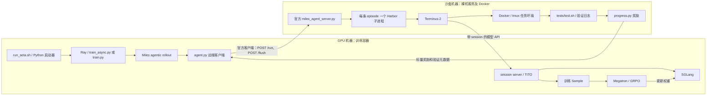

# SETA + Qwen3-8B 的 Miles 远端 Harbor 训练

部署命令以 [Quick Start](seta_quick_start.md) 为准。本文件解释实现、配置归属、训练数据和验证范围。当前仅维护“GPU 训练节点 → 远端 CPU Harbor 服务”这一条路径，没有在 GPU 进程中直接启动本地 Harbor 的回退分支。

## 1. 两台机器分别执行什么



GPU 容器运行训练 Python 3.12 环境，创建 Ray、训练/推理 worker 和 session server。远端裸机运行独立 Python 3.13 Harbor 虚拟环境、HTTP 服务及本机 Docker CLI；Docker daemon 创建该机 CPU 沙盒。远端不加入 GPU 的 Ray 集群，不安装 Megatron，不需要 HF 模型或训练 checkpoint。

服务直接采用随仓库交付的 Harbor `miles_agent_server.py`，GPU 请求复用 Miles 官方 `swe_agent_function.py` 客户端。SETA 只扩展 trial runner 与少量通用协议字段，不再维护另一套 HTTP 轮询服务。远端 Harbor 子进程调用远端本机 Docker；代码、任务、日志和配置均属于远端本地磁盘。

若以后希望沙盒与训练在同一物理机，也可以部署同样的服务、将 endpoint 改为该机可达地址。仍需正确配置服务、路径和回连地址，仅改一个 IP 不能替代部署。

## 2. 代码与 runtime 的关系

| 路径 | 职责 / 实际运行位置 |
| --- | --- |
| `my_scripts/run_seta.sh` | GPU 容器入口；分块默认变量、W&B 认证、日志和 Python 启动 |
| `scripts/run_qwen3_8b_seta.py` | 参数预检查、配方、模型转换、command_utils 提交 |
| `examples/seta/agent.py` | GPU 侧多节点限流、调用官方客户端、奖励有效性检查 |
| `examples/swe-agent-harbor-docker/swe_agent_function.py` | 官方 `/run` 客户端；支持显式 endpoint、鉴权与额外结果元数据 |
| `remote_config.py` / `remote_pool.py` | GPU endpoint 配置、跨进程并发槽 |
| `remote_server.py` | 读取部署配置后 exec 官方服务的启动入口，不实现 HTTP 接口 |
| `harbor/miles_agent_server.py` / `agent_server/` | 远端官方服务：并发、每轨迹子进程、心跳、取消和请求日志 |
| `harbor_trial.py` / `terminus.py` | 通过 HARBOR_TRIAL_RUNNER 加载的 SETA runner、Terminus-2 预算处理 |
| `docker_adapter.py` / `remote_images.py` | 远端代理注入、稳定任务镜像、构建锁、基础镜像预取与缓存 |
| `progress.py` | 从验证日志重算论文训练口径的奖励 |
| `my_scripts/configure_seta_remote.py` | 在沙盒裸机安装持久服务配置与专用账号 |
| `seta_miles_runtime/seta-remote/config.json` / `setup.py` | 仓库内的完整部署输入与自动部署入口；生成远端运行配置和 GPU endpoint/token |
| `my_scripts/stop_seta.py` | 先停止记录中的 Ray 作业，再按 run_id flush 它的远端 episode；兼容旧版专用容器记录 |
| `seta_miles_runtime/harbor/` | 随仓库交付的 Harbor 固定源码与锁文件，远端安装自己的 `.venv` |
| `seta_miles_runtime/remote/` / `secrets/` | GPU 本地 endpoint JSON、活动运行记录和凭据，Git 忽略 |
| `seta_miles_runtime/models/` / `runs/` | GPU 本地模型转换与运行产物，Git 忽略 |

上表未加目录前缀的 SETA Python 模块均在 `examples/seta/`；`harbor/` 指 runtime 下的源码。Miles 核心源码没有修改。官方客户端增加了可选参数；vendored Harbor 的通用扩展记录在 [补丁说明](../seta_miles_runtime/harbor-local-patches.md) 与 `harbor-local.patch`，包含 runner 插件、结果 metadata、按 run_id 取消、文件凭据和安全清理开关。SETA 奖励和代理逻辑仍在 `examples/seta`。

runtime 是仓库的子目录，不再维护外部独立的 seta_miles_runtime。GPU 脚本通过自身所在目录推导 REPO_DIR，继而推导 RUNTIME_DIR；Python 启动器拿到的是具体参数和 worker 环境，不会自动扫描 runtime。部署输入以仓库内 seta-remote/config.json 为准；setup.py 复制代码/任务、安装依赖并生成运行配置。**服务运行时读取远端自己的 server.json 和 service.env，不读取 GPU 上的部署文件。** 两台机器目录名字可以不同，不要求共享盘或一致的绝对路径。

Harbor 源码、锁文件、许可证、来源记录及 seta-remote 的无密钥部署配置/脚本纳入 Git；`.venv`、模型、生成的运行配置、token、任务副本、日志和缓存忽略。按用户选择，run_seta.sh 不在 Git 忽略规则中；部署工具仍排除该 GPU 入口，不把训练端 W&B 设置复制到沙盒机。

## 3. 数据读取、环境构建与交互

### 3.1 准备阶段：一条任务变成一行 JSONL

[prepare_dataset.py](../examples/seta/prepare_dataset.py)遍历 SETA_Synth 与 SETA_Evolve 中含 task.toml 的目录，读取 instruction.md，生成：

```json
{"prompt":"任务指令……","metadata":{"instance_id":"SETA_Synth__nl2bash__004","task_id":"nl2bash__004","subset":"SETA_Synth","agent_name":"terminus-2"}}
```

同时默认复制任务到扁平 `tasks/<instance_id>/`。`--no-copy-tasks` 只生成 JSONL、不复制任务；当前完整数据准备没有启用它。原始任务变化后应重新准备或主动更新副本，复制器不会覆盖已经存在的完整副本。

metadata.agent_name 是复用通用 Harbor `build_trial_config` 的接口约定，不是 Miles 强制要求数据指定脚手架。该通用函数缺省选择其他 agent；本方案预检查明确要求 terminus-2，避免误用。通用 Miles 可以在训练脚本中选择自定义 agent 函数，数据的 metadata 完全由这个函数定义。

GPU 的 RolloutDataSource 读取 train.jsonl，抽取任务并复制为同任务的 N 个 Sample。JSONL 不包含 Dockerfile 或测试脚本；HTTP 只传任务 ID、模型会话、采样参数、受限 recipe 设置，不传输整个任务目录。远端通过自己的 tasks_dir 定位同名任务。

### 3.2 远端究竟读取哪些文件

```text
tasks/<instance_id>/
├── instruction.md
├── task.toml
├── environment/
│   ├── Dockerfile
│   ├── docker-compose.yaml   # 可选
│   └── 其他构建素材
├── tests/
│   ├── test.sh
│   └── 测试、数据及可选 weights.json
└── solution/                 # 参考解；正常 rollout 不提供给模型
```

| 文件 | 使用方式 |
| --- | --- |
| `instruction.md` | Harbor 读取并作为 Terminus-2 的实际任务文本 |
| `task.toml` | 环境、超时、资源、agent/verifier 元信息 |
| `environment/Dockerfile` 及素材 | 作为 build context 构建任务镜像 |
| `environment/docker-compose.yaml` | 如存在，参与 Harbor Compose 合并，声明服务或设置 |
| `tests/` | agent 结束后由 verifier 上传并执行 `/tests/test.sh` |
| `solution/` | 仅参考解检查使用，正常 RL 不读入 prompt |

当前适配器不使用 JSONL prompt 覆盖 instruction.md，因此二者应来自同一次数据准备；只改 JSONL prompt 不会改变实际任务。测试和参考解不会由适配器自动加入初始模型上下文。

### 3.3 从 Dockerfile 到持久终端

官方服务取得并发槽后，为这一条 episode 启动 Harbor Python 子进程。子进程通过 HARBOR_TRIAL_RUNNER 加载 SETA runner，检查任务、CPU 限制及磁盘余量，必要时预取 Dockerfile 的基础镜像；然后 Trial 读取任务，创建本机 DockerEnvironment。任务不得请求 GPU/privileged，Compose overlay 显式使用 runc。

Harbor 先合并自带 Compose 模板和任务配置，再附加本项目生成的 `seta-docker-defaults.json`：显式传递默认代理 build args/environment、为普通任务指定稳定镜像名。原任务文件与 docker_config/config.json 都不被改写。构建使用跨子进程文件锁，相同任务并发首次执行只构建一次；后续复用镜像，但每条 episode 的容器可写状态独立。

Terminus-2 在任务容器里创建 tmux 持久终端。每轮模型响应含 analysis、plan、commands 等 XML；控制器解析命令，将 keystrokes 发给 tmux，再读取终端屏幕作为下一轮观察。前一轮的 cd、变量、文件修改和后台程序可以影响下一轮，不是每步重新起容器或新 shell。

keystrokes 是发送给终端的字符/按键，shell 命令通常需包含末尾换行；也可以发送 Ctrl+C。duration 是发出按键后的观察等待时间，**不是命令运行超时**。模型可以后续继续等待、检查或中断。一次模型响应可包含多条命令，所以命令数不等于模型调用数。

Agent 完成、达到轮数或耗尽长度预算后进入验证。verifier 将 tests 上传并执行 test.sh，测试 agent 留下的状态，保存 CTRF / pytest 输出与 Harbor reward 文件。最后删除本 episode 容器/网络，保留远端 trial 日志。服务只管理自己的任务镜像缓存，不对共享 Docker 做全局 prune。

## 4. 一批训练的详细调用链

### 4.1 启动器 → command_utils → Ray

run_seta.sh 设置默认变量，外部 export 可覆盖；EXP_NAME 表示实验，RUN_ID 表示一次启动。W&B key 写入 600 权限的 NETRC 后从提交环境中移除，避免出现在 Ray argv 和日志。日志以 EXP_NAME + RUN_ID 命名。

Python 启动器检查模型、JSONL、所有 endpoint 的 health、协议与容量，生成 Qwen 结构参数和训练参数。command_utils.execute_train 负责 Ray 启动与 job 提交；async 选择 train_async.py 和 --fully-async，sync 选择 train.py 和 --colocate，仅采样模式使用 train.py 的 debug-rollout-only。卡数和训练拓扑由 Python 启动器统一推导，shell 仅传入配置；同步/异步开关、全局 train/infer 卡数与多机接入步骤见 [Quick Start 第 4 节](seta_quick_start.md#4-常用调整与多机注意)。

异步模式中，Megatron 和 SGLang 使用独立 GPU，后台采样持续生成任务组，训练从完成缓冲区取出一批后更新。权重同步采用默认 broadcast，每次训练更新后短暂以 in_place 暂停推理，保留 KV cache 后恢复；训练计算期间采样继续。异步轨迹可能跨越权重版本，使用配方中的 IcePop 重要性修正；缓冲、陈旧度和调度细节见 [Fully Async RL](user-guide/fully-async.md)。同步模式中，两者分时复用全部 GPU，完成采样、训练和权重同步后才开始下一批。Ray 管理进程、资源和数据引用；不解析任务、不操作终端、不计算测试通过率。

### 4.2 任务组 → session → HTTP episode

默认一个 rollout 批次收集 8 个有效任务组，每组 16 条 episode，共 128 条有效轨迹。每条 episode 创建一个独立 Miles 模型 session。generate 调用 agent.run；它先取得训练总并发槽，再取得某个 endpoint 的跨进程文件锁槽，提交远端请求。

一个远端请求对应**一条 episode、一个 Harbor 子进程及其沙盒**，不是整个 16 条任务组，也不是单轮模型调用。Miles 的 agent-function 子进程隔离是 GPU 外层机制，与远端 Harbor 子进程不同。

agent.py 调用官方客户端，将会话 URL、任务 metadata 和受限 SETA 参数发给 `POST /run`。这条 HTTP 请求一直等待到轨迹结束；官方服务用信号量控制并发，额外请求在服务内等待。`request_id` 用于关联轨迹文件，**不提供请求幂等保证**；客户端没有自动重发 `/run`，避免网络错误后重复执行。

父服务把请求 JSON 经 stdin 交给 `python -m agent_server.trial_runner` 子进程；子进程加载 SETA runner，运行 Harbor，再通过 stdout 的结果标记把奖励与元数据交回父进程。父服务返回 RunResponse，官方客户端合并 metadata，SETA wrapper 将其回填 Sample。HTTP 不回传模型 token 大数组，也不再调用旧 `/runs` 轮询接口。

### 4.3 Terminus-2 → TITO → SGLang

远端 agent 的模型 API 指向 GPU session server 的专属会话地址。请求携带本轮消息及采样参数；session server 处理 Qwen 模板和 token 历史，再把推理转交 SGLang。返回文本给远端 Terminus-2 解析执行。

模型请求和沙盒结果是两条独立通道：TITO 在 GPU 保存真实采样 token/log-prob，远端 HTTP 返回环境奖励。episode 结束后，Miles 按同一 session 将二者合并。远端不需要读取 GPU 的输出文件，也不把 GPU 文件路径当作自己的路径。

non-thinking 由 enable_thinking=false 控制；Terminus XML 中的 analysis/plan 是普通策略输出文本，仍参与训练。

### 4.4 验证、动态补采和 GRPO

progress.py 优先读取保存的 ctrf.json，否则解析 pytest 摘要，得到逐测试通过/失败。有效零分是正常奖励；缺失验证报告、构建失败、模型连接故障等标为无效，Sample 为 ABORTED，整组丢弃。

实验组由 Python 启动器的 `--algorithm` 决定：GRPO 关闭同分过滤，DAPO 开启 `apply_reward_nonzero_std_filter`，旧 `run_seta.sh` 默认 DAPO。过滤开启时，同任务全部轨迹奖励相同的组被过滤并继续补采；关闭时有效全零/全同分组可以进入训练，其 GRPO 优势通常为零。这是动态筛选，不是准备阶段过滤 4,567 条数据。128 条是有效轨迹目标，实际启动 episode 数可能更多。

两组共同使用 `--use-tis` 加内置 `icepop_function`，范围继承核心默认 `[0,2]`：范围内按实际重要性比率加权，范围外该 token 的 policy-gradient 项置零，原 loss mask 分母不变。PPO surrogate clip 由启动器显式设置为 `[0.8,1.28]`（epsilon 为 0.2/0.28）；它与 IcePop 是不同的比率和处理步骤。可通过 `--extra-args` 覆盖数值，但同分过滤必须通过 `--algorithm` 选择。

训练将 Sample 转成 tokens、长度、loss mask、奖励和 rollout log-prob；同组奖励经 GRPO 归一化得到优势。v2收集阶段通过SETA后处理钩子复用默认叶路径mask归属规则，并执行与reward_func相同的验证有效性检查；无效结果标为ABORTED，有效零分保持有效，全通过bonus不变。Megatron 重算固定轨迹的 token 概率，计算 PPO clipped surrogate 和 IcePop 修正，组织 microbatch、反向传播和优化器更新，再将 actor 权重同步到 SGLang。不会每步重新导出 HF 模型并重启推理。

## 5. 最终轨迹如何参与训练

当前启动器使用 session v2。连续追加且没有分支的多轮 episode 仍合成一个叶路径 Sample，不按每个终端 step 拆开。v2记录树状历史；若存在保留的多条叶路径，沿用 Miles 的同一 rollout/episode 标识、组语义和共享动作只训练一次的 mask 规则，不能把每个叶子当成独立环境尝试。线性轨迹例如：

```text
模型调用 1：P → A1
模型调用 2：P + A1 + O1 → A2

tokens：               P | A1 | O1 | A2
response 区间：           | A1 | O1 | A2
loss_mask：              |  1 |  0 |  1
rollout_log_probs：       | lp1|  0 | lp2
reward：这一整条 episode 的最终测试奖励
```

P 为初始提示，A 为模型输出，O 为反馈/后续输入。只有实际模型输出 token 参与策略 loss，终端观察仅作为后续条件。response_length 包含中间反馈，不等于生成 token 数。最后一次模型回复后的观察，若未再进入模型请求，不会凭空添加到训练序列。

Megatron 对固定序列做因果前向，A1 看不到未来 O1，A2 可以看到 O1；不需要再次与沙盒交互。同一轨迹优势用于所有 mask=1 的模型 token，不另做逐命令奖励或局部 credit assignment。

GPU 调试产物在 `runs/<EXP_NAME>/dump_details/`：trajectory JSONL 便于阅读，rollout_data/*.pt 保存 tokens/mask/log-prob 等数组。正常训练直接使用运行时数据引用，这些落盘文件不是每批训练的输入接口。远端 state/trials 保存终端交互、测试输出和验证证据，两侧靠 remote_request_id 对应。

本轮真实远端小批次的 GPU 留档包含 4 条有效轨迹，读取结果如下；不是构造的训练数据：

| Sample index | 总 token | response 区间 token | 模型 token（mask=1） | 通过测试数 | reward |
| --- | ---: | ---: | ---: | ---: | ---: |
| 0 | 1,960 | 815 | 646 | 2/10 | 0.2 |
| 1 | 6,900 | 5,755 | 2,149 | 2/10 | 0.2 |
| 2 | 5,082 | 3,937 | 2,715 | 2/10 | 0.2 |
| 3 | 6,529 | 5,383 | 1,610 | 7/10 | 0.7 |

对应 `real_rollout_summary.json` 保存 request_id 与远端 trial_dir，便于跨机器对照。该组已有奖励方差；优化器尚未成功完成的限制见第 10 节。

### 上下文管理与长度终止

当前明确关闭 Terminus-2 摘要并保持 linear_history。已产生的历史保持前缀关系，TITO 记录真实 token，不对结束后的文本重新 tokenize。

新增 SetaTerminus2 仅捕获已知上下文/序列/单轮长度预算异常：**结束 agent 后继续验证已有环境状态**，不伪造续写、不修改截断回复、不启用摘要。这样预算耗尽的有效尝试仍有真实部分通过奖励；未知模型故障、构建异常与取消不会伪装为正常完成。这是本次迁移明确的终止策略。

若以后开启压缩，压缩前后请求不再共享同一个 token 前缀，不能强行拼成线性训练样本。虽然当前已使用 session v2，仍需单独验证压缩后的叶路径、实际输入、采样概率和 loss mask；同一环境 episode 的最终奖励可分配给这些片段，并保持原 episode 分组。外部摘要作为条件时 mask=0；若训练策略自己生成摘要，其 token 是否参与 loss 则需显式设计。当前没有实现或验证压缩训练。

此前核对原 SETA Qwen3-8B/AReaL 配方：使用 CAMEL AgentTrain，threshold=None，固定 CAMEL 提交 `57d2f98bc315f1522269a4cad7b2a478cfee3b12` 的摘要检查因此直接返回；默认窗口也不裁剪旧历史。证据见原训练配置及[固定版本 ChatAgent](https://github.com/camel-ai/camel/blob/57d2f98bc315f1522269a4cad7b2a478cfee3b12/camel/agents/chat_agent.py)。论文 A.7 的终端输出截断不等于历史摘要，因此当前不为对齐该入口开启压缩。

## 6. 奖励：weights.json 和 reward.json 的作用

训练奖励为 `通过测试数 / 总测试数 + 全通过 bonus`，默认 bonus=0.2。跳过、错误和未通过均计入未通过；无法解析逐测试结果则无效，不用 Harbor 二元 reward 代替通过率。

weights.json 不是无用文件：部分任务的 tests/test.sh 会按它计算加权 reward.json。但本次训练**不累加 reward.json 的分项数值，也不按 weights 加权**，而是根据逐测试结果重算。

reward.json / reward.txt 仍是 Harbor verifier 的输出协议，缺失或格式不合法可能导致 trial 验证失败，不能因为最终数值被重算就删除它们。仅在任务根目录的 weights.json 也不会自动上传为 /tests/weights.json，只有 tests 目录中的文件随 verifier 上传。

依据：[论文 §3.4](https://arxiv.org/pdf/2607.10891v2#page=8)及原仓库 `seta_env/verifiers/reward_fn.py` 的 pass_ratio_with_bonus 均采用等权通过率。本地原 verifier 先解析 CTRF/pytest，当前实现保留这一训练口径。正文/函数默认 bonus 为 0.2，论文附录表 8 则写 0.5，本地实验文字另有 1.0；当前选实际函数默认 0.2，可显式修改 FULL_PASS_BONUS。

单任务奖励成功不代表全部任务的输出格式已验证：例如某些脚本把 CTRF 写在容器 /tmp 而非 /logs/verifier，仍需依赖 pytest 摘要或增加结果回传；没有可解析逐测试结果会被明确丢弃。

## 7. 代理、路径和配置优先级

**远端 DOCKER_CONFIG 来自远端 systemd EnvironmentFile，是远端本地路径。GPU run_seta.sh 不传它，也不通过 HTTP 覆盖它。** 因此不依赖部署者是否还保留某个 export 的 shell。

| 网络阶段 | 配置所属位置 |
| --- | --- |
| GPU W&B / 训练外网访问 | GPU 脚本的 WANDB_PROXY 与 NO_PROXY |
| GPU → 远端 HTTP | 客户端 trust_env=false，直接访问 endpoint |
| 远端 → GPU 模型会话 | 接受 Miles 每条请求的 HTTP(S) 地址；runner 自动将模型主机加入本轨迹 NO_PROXY，无主机白名单；会话心跳直接连接 |
| 基础镜像预取 | 远端 service.env 的 HTTP/HTTPS 代理，Crane 下载后 docker load |
| daemon 原生 pull | 沙盒宿主机 Docker daemon 代理；与客户端 JSON 分开 |
| Dockerfile RUN / 任务容器 / verifier 下载 | 远端 docker_config/config.json 默认代理，由适配器显式注入 Compose |

任务有 Compose 文件但未设置代理时，仍使用上述默认值；显式写代理（包括空值）时任务优先。为避免大小写变量互相冲突，一种大小写被显式配置时，适配器不再注入另一种默认值。任务脚本仍可在运行时自行 unset/export；这不是强制流量代理。

本次实际发现远端 Compose 2.16 构建不能可靠自动继承客户端默认代理，因此新增明确 overlay，而不再依赖“Docker CLI 会自动注入”的假设。已用真实任务构建和参考解验证。

service.env 不等于 Docker 任务环境：前者控制远端进程下载/模型回连，后者控制任务内部下载。两端机器的配置文件彼此独立，不会因同名而互相覆盖。

修改部署配置的 node.proxy 后再次 apply，会同时更新远端进程代理与 Docker 默认代理，并重启选定的空闲 Harbor 服务；Docker 仓库认证等其他客户端字段保留。不再要求用户手工 mkdir、编辑多份配置或传递 token。活动 episode 存在时拒绝部署，避免中断训练。

本次另发现 Docker Hub 在已配置代理时仍返回 TLS EOF，增加服务级 registry_mirrors 配置。它只映射 Docker Hub 镜像，在可用镜像站下载后 tag 回任务原引用，不修改共享 daemon 配置；其他 registry 保持原地址。安装器选项和操作统一见 Quick Start。

## 8. 并发、故障回收和资源边界

GPU 的 MAX_CONCURRENT_TRIALS 限制本次训练总 episode 并发；endpoints.json 中每项限制这次训练对该机的并发；server.json 的 max_concurrent 限制该服务全部客户端合计并发。GPU agent 默认以多个子进程运行，因此节点槽使用 flock 跨进程共享，不能用普通模块内 asyncio.Semaphore 代替。

训练请求携带官方 session_server_id / session_server_instance_id，远端使用官方心跳机制检查 GPU session server。当前服务配置每 10 秒检查一次、单次超时 5 秒、连续失败 3 次后取消相关任务；这不是固定 45 秒租约，也不依赖客户端轮询。无会话标识的参考解检查不启用模型心跳，仍受 trial 总超时约束。

训练启动器使用 Miles 原生 `job_lifetime="launcher"`：Ctrl+C / SIGTERM 会停止所属 Ray 作业。原来默认 independent，停止启动器可能只断开日志跟随，Ray、session server 和远端任务仍然存活，因此心跳回收也不会触发。专用 Ray 模式随后停止本地 Ray；接入外部 Ray 时仅停止该作业。

run_seta.sh 捕获 INT / TERM，在独立进程组中启动 Python，转发停止信号；日志转发进程也独立，避免终端 Ctrl+C 先杀死 tee、用断管错误打断清理。EXIT 清理覆盖中断、报错和正常结束。每次启动保存独立 run.json，记录 run_id、Ray submission_id、Ray 地址和 endpoint 配置路径。清理始终使用自己的记录，避免 active_run.json 被后一次启动覆盖后误取消其他训练。先请求并等待 Ray 作业停止，再向所有配置节点调用官方 `POST /flush`，用 run_id 只取消本训练的请求；单个节点请求失败仍尝试其他节点。停止 Ray 超时会告警，仍尝试远端回收；网络恢复后可重试手动停止。日志会记录退出码及 flush 结果。手动停止命令和记录路径见 [Quick Start 第 1 节](seta_quick_start.md#1-已配好当前环境直接启动)。旧记录没有 submission_id，手动停止仍兼容原先停止专用容器 Ray 的方式。

Miles 补采终止通过同一 abort hook 回收剩余 episode。flush 不永久封禁 run_id，正常重启使用新 RUN_ID。取消先给子进程 SIGTERM，让 Harbor 协程收集日志、停止并删除容器；超过 120 秒才强制结束进程组。flush 的 HTTP 返回表示已请求取消，实际容器删除随后完成，不能将返回瞬间等同于资源已回收。服务重启不重放旧模型会话。网络失败或 Flushed 响应缺少有效奖励标记时，轨迹明确丢弃。

SIGKILL 无法执行退出钩子。若会话服务也随 GPU 作业消失，远端心跳仍是兜底；如果仅强杀外层 shell、模型会话仍存活，需使用手动停止命令。终端挂断 HUP 仍按此前约定忽略，不等同于主动 Ctrl+C。

官方请求日志在远端 `state/dashboard/requests.jsonl`，Harbor 交互与验证结果在 `state/trials/`。原轮询服务产生的历史状态 JSON 和 child.log 仅作旧记录，新服务不再读写它们。HTTP 请求日志不等于模型训练轨迹；后者仍由 GPU TITO 保存。

镜像缓存只回收本服务前缀且含所属标签的镜像，正常 rm 不使用 force；被容器引用的镜像保留。不执行全局 prune，不碰其他人的容器。任务镜像默认保留最近 16 个；磁盘可用低于按并发推导的阈值时拒绝新任务，规则见第 11 节。基础镜像、Docker 构建缓存与长期 trial 日志仍须监控，缓存上限不等于全机磁盘硬配额。

远端专用账号、空 CUDA_VISIBLE_DEVICES、NVIDIA_VISIBLE_DEVICES=void、systemd 设备限制及 CPU 任务配置共同保证不主动分配该机 GPU。该服务仍是有 Docker 权限的受信任任务执行器。当前会拒绝 privileged / GPU / devices 透传任务；全量数据保留了两条 privileged 任务，执行时会报告无效并补采，而不是过滤掉 JSONL：

- `SETA_Synth__unix_linux_se__456620`
- `SETA_Evolve__ask_ubuntu__830__d1`

## 9. 模型、预算与论文对齐范围

HF 模型供 tokenizer、配置和推理初始化；Qwen3-8B_torch_dist 是预转换的 Megatron 参数布局。没有可恢复训练 checkpoint 时用 ref_load 初始化 actor，有 checkpoint 则由 load 恢复模型/优化器等状态。SAVE_PATH 控制 load/save，EXP_NAME 稳定便于续训，RUN_ID 仅用于日志和一次远端运行身份。

Miles 也有通过 Bridge 直接读 HF 的路径，但本启动器选择已验证的预转换方式；不能据此说整个 Miles 都必须手工转换。KL 系数为零时，ref_load 的命名不代表额外执行参考模型 KL 前向。

当前 epoch 到批次数使用先整除再乘：

```text
每个名义 epoch：4567 // 8 = 570 个 rollout 批次
40 epoch：570 × 40 = 22,800 批
每批：8 个有效组 × 16 条轨迹 = 128 条有效轨迹
```

此前 22,835 来自一次计算 4567×40÷8，取整次序不符，已纠正。动态补采增加环境执行次数，因此不保证每条任务恰好训练 40 次。NUM_ROLLOUT 正数覆盖 epoch 总批次预算；续训读取已完成批次，不表示“再额外跑 N 批”。

这是一份迁移配方，不是严格数值复刻：论文/原入口使用 AReaL、CAMEL、过滤后 560 任务；本实验使用 Miles、Terminus-2、完整 4,567 任务。组内 GRPO 归一化和当前 IcePop 配置不等同于逐项复制 AReaL 的优势处理与 decoupled loss。每轮输出上限与线性序列预算按当前启动器设置，没有另设论文总生成 10,240 token 预算。

当前工具镜像的 FlashAttention 4 在 A100 前向可运行、反向会报 unsupported compute capability；尝试 fused 时当前输入布局也没有可用后端。初始化时移除 flash-attn-4，保留已有 FA2，训练维持 ATTENTION_BACKEND=flash，推理保持 triton。FA2 已单独进行真实 CUDA 前向/反向检查；该环境兼容处理不改变 agent、奖励或 GRPO 算法。

此删除步骤只针对当前镜像的 A100/SM80 兼容问题。H20、H200 属于 Hopper/SM90，无需因此删除 FA4；镜像中的 TE 在 SM90 且 FA3 可用时优先选择 FA3。架构依据和操作分支见 Quick Start 第 2 节，尚无本实验 H20/H200 的实际训练验证记录。

## 10. 本次实际部署与验证记录

| 项目 | 当前部署 |
| --- | --- |
| GPU 节点 | 124.16.138.150，单机 8×A100 80GB |
| GPU 容器 | miles_seta_zhangkaiqi2024，miles-seta:tools-v1，init/restart 已配置，无 Docker socket |
| GPU 仓库 | /ceph_home/zhangkaiqi2024/miles |
| GPU 数据 | /ceph_home/zhangkaiqi2024/seta_miles_data/train.jsonl |
| GPU 模型 | HF 保持原目录；转换权重位于 runtime/models |
| 沙盒节点 | 124.16.138.144，仅 CPU，不使用其 GPU |
| 沙盒独立目录 | /opt/seta-zhangkaiqi2024，位于 /dev/sdg3 ext4，不是 Ceph |
| 远端代码 / 任务 | root/miles 与 root/tasks；4,567 任务独立副本 |
| 远端运行依赖 | root/python 的 3.13.16、root/miles 下独立 Harbor .venv |
| 远端服务 | seta-harbor-zkq，端口 18080；2026-11-04 更新为容量 32 |
| 远端账号 | seta-sandbox-zkq，home 在 root/home，运行时禁止访问 /ceph_home |
| GPU 服务 | seta-training-zkq；操作见 Quick Start |

旧 GPU 容器已删除重建；删除前保存了故障 Ray 日志。远端复用已有 Docker / Compose / Buildx，没有重启共享 daemon、操作其他人的 GPU 任务。

GPU 宿主机使用 systemd cgroup driver，实际遇到 daemon-reload 后容器 NVML Unknown Error；最终容器增加显式 NVIDIA 设备映射，避免依赖 runtime hook 的隐式设备权限。此问题与训练脚本收到 SIGHUP、容器 restart 策略是不同层级，详见 Quick Start 的创建命令。

真实远端参考解检查：nl2bash__004 通过 10/10，奖励 1.2；真实 Qwen 多轮请求已经跨机器执行，最近一组奖励为 0.2、0.2、0.2、0.7。为避免早期同分组不断补采，最小检查曾临时关闭同分组过滤，保留真实奖励；该历史检查采用全量数据入口默认动态过滤；当前 GRPO/DAPO 可分别控制过滤。

远端镜像下载已额外验证：同一份持久 service.env 配置下，通过镜像站下载 python:3.13-slim，导入 daemon 并 tag 回原引用成功；证据为 base_image_mirror_check.log。Docker CPU/代理/独立挂载的实测证据保留在 remote_cpu_proxy_proof.json。

2026-10-29 已完成单机 8 卡、远端 144 沙盒的有限真实训练检查：固定 RolloutExecutor 在 Ray head，使用一条任务、每组 4 条轨迹、2 个 rollout 批次。两次 GRPO 更新的梯度范数为 1.7313、1.6180，两个 checkpoint 均保存成功；W&B 在线同步正常。随后通过独立的 debug-train-only 运行成功加载 iteration 1 和 rollout 数据进度，正常退出。训练使用 NVLink P2P 限制、关闭 IB 和 SGLang custom all-reduce，避免当前机器 IOMMU 配置下未经验证的通信路径。检查没有执行全量数据的正式训练，也未验证双机。

单机仅有一个可调度节点，head 固定不改变实际节点；本次检查未做开关参数的独立性能对照，也不能推断双机性能。第一批训练计算约 20 秒，第一份 checkpoint 保存约 166 秒；初始化和存储耗时与固定 head 无法直接归因。GPU 故障历史与恢复证据见 [GPU 故障交接](gpu_reboot_handoff.md)。

本次官方 agent-server 重构的 CPU 检查：23 项通过，覆盖服务容量、按 run_id 取消、鉴权、CPU 任务边界、代理优先级、镜像映射、部署、停止、奖励与官方客户端；Harbor 相关原有单测 150 项通过；SETA runner 5 项通过（包括用逐测试奖励覆盖通用标量、无验证报告判无效、禁止客户端覆盖远端配置）。改动的 Harbor 服务通过 Ruff 和 scoped ty 检查。另有 Terminus 预算异常和取消/基础设施异常 2 项历史检查通过。启动器针对性 4 项通过；全仓启动器套件为 577 通过、15 失败、10 错误，涉及其他入口已有的 API/快照问题，完整日志保留，不报告为全绿。

已实际执行新版 setup.py --mode apply，远端运行官方 agent-server，health 协议为 harbor-agent-server-v1；鉴权、路径和容量检查通过。保留原 systemd unit 的启动入口，仅让该入口 exec 官方服务，因此这次更新不需要 daemon-reload；只重启专用 Harbor 服务，未重启共享 Docker。临时 token 导出文件已清理。通过 GPU 容器中的官方客户端访问真实 CPU 沙盒，参考解 10/10、奖励 1.2、有效性与 trial_dir 正常回传。按 run_id 取消的真实沙盒已删除，另一运行正常返回 1.2。证据在 `diagnostics/agent_server_refactor/` 的 oracle_result.json、official_client_result.json、cancel_result.json 和各测试日志。

2026-10-29 已移除 GPU 回连主机列表及白名单校验，并更新远端服务。相关部署/客户端检查 15 项、SETA runner 检查 10 项、Harbor 单测 150 项通过，scoped ty 检查通过。实际 CPU 集成检查中，宿主机临时提供固定 XML 回复的模拟 OpenAI 接口；远端 Terminus-2 的两次模型请求和三次会话心跳均直接来自沙盒机，未经过下载代理。经 tmux 执行 pwd、完成任务确认并运行真实 tests/test.sh 后，得到 2/10、奖励 0.2，summarization_count=0。证据在 `diagnostics/callback_access_20261029/`。临时接口已关闭；该检查未使用真实 Qwen，也未覆盖 TITO token 采集或 GPU 更新。

2026-10-29 退出回收检查：真实 Bash 入口收到进程组 SIGINT（模拟终端 Ctrl+C）和 SIGTERM，原生 Ray CPU 作业均变为 STOPPED；远端 144 的真实 Terminus-2 / Docker 沙盒分别在约 17.1 秒、15.9 秒后删除。同一服务的其他 run_id 对照沙盒继续运行，随后单独清理；既有训练保持 RUNNING。使用临时隔离的 agent-server 和模拟模型接口，不分配 GPU、不重启生产 Harbor。最终测试 worker、容器、网络均为 0，临时服务已停止。相关自动化检查 33 项通过，覆盖前台进程组信号、正常结束、失败退出、计划模式不清理、运行记录隔离、Ray 超时及多节点部分失败；启动器针对性 4 项通过，全仓启动器结果仍与上述基线一致，Ruff 检查通过。证据位于 `seta_miles_runtime/diagnostics/shutdown_20261029/`，包括 integration_result.json、ray_status_after.json、remote_cleanup.log 和测试日志。

本轮原始日志与旧文档归档在 GPU `seta_miles_runtime/diagnostics/remote_migration_20261028/`。并未实际执行全部 4,567 个任务，完整任务的镜像、测试结果格式和资源需求仍可能暴露个别兼容问题；服务会明确标记无效，避免混成任务零分。

## 11. 按并发自动推导资源预算

只需在节点配置填写 max_concurrent。安装器 configure_seta_remote.py 按以下规则生成远端 server.json 和 systemd unit，不再接受 cpu_quota、memory_max、min_free_gb 三个手工配置项：

| 生成项 | 推导规则（N = max_concurrent） | N=16 示例 |
| --- | --- | --- |
| CPUQuota | max(200, 100 × N)% | 1600%，约 16 个逻辑 CPU 的时间 |
| MemoryMax | max(8, 4 × N) GiB | 64 GiB |
| min_free_gb | max(15, N) GiB | 16 GiB |

这是按并发增长的默认保护预算，不是实测容量预测或资源预留。CPU/内存限制覆盖 Harbor 服务及其 Python/CLI 子进程，不覆盖 Docker daemon 独立创建的任务容器。单个任务继续由 task.toml 声明资源；不注入统一的任务资源覆盖值。磁盘值是 state_dir 所在文件系统的剩余空间接单阈值，不是单任务磁盘上限，也无法单凭并发预测基础镜像的大小。

修改并发后，先停止使用该节点的训练，再按 Quick Start 执行 apply。旧配置若仍保留上述三个字段，会明确报错并要求删除，避免误以为手工值仍在生效。image_cache_keep 仍独立控制本服务任务镜像缓存数量。

2026-11-04：按当前部署配置将144专用服务容量由16更新为32；setup.py部署及鉴权/协议/容量/服务状态检查通过，更新后活动任务0。G1基线验收和短训练的后续证据统一记录在[P2O实现进度](p2o_implementation_progress.md)，不以健康检查代替真实训练验收。
